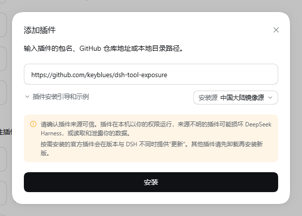

# 工具暴露 · dsh-tool-exposure

在 DeepSeek Harness（DSH）里按角色管理工具可见性。你可以整组开启或隐藏一个插件或 MCP 服务器提供的工具，再为单个工具设置例外。保存后的规则用于新建会话。

[安装](#安装) · [使用指南](docs/usage.md) · [配置参考](docs/configuration.md) · [开发指南](docs/development.md)


## 安装

适用于使用官方 `dsh-base` 的 DSH 环境。支持的 DSH 版本范围为 `>=0.2.2-rc.3 <0.3.0-0`。Node.js 版 DSH 需要 Node.js 24.9 或更高版本。

1. 在 **DSH 左侧菜单**打开「插件」。
2. 点击右上角「添加插件」旁的下拉箭头，选择「安装第三方插件」。
3. 在弹窗的输入框中粘贴 GitHub 仓库链接。

   ```text
   https://github.com/keyblues/dsh-tool-exposure
   ```

4. 点击「安装」。安装完成后重启 DSH，打开左侧菜单中带眼睛图标的「工具暴露」。如果入口收纳在「更多」里，可在其中打开或固定到侧栏。



也可以在同一个输入框填写 npm 包名 `dsh-tool-exposure`。[查看 npm 包](https://www.npmjs.com/package/dsh-tool-exposure)

## 快速使用

1. 选择要配置的角色。角色卡片显示名称、说明、预设 ID 和可见工具数量。
2. 在「默认规则」里选「默认开放」或「白名单」。前者适合隐藏少数组，后者适合只放行指定工具。
3. 用组开关批量设置工具，或点击组名展开后调整单个工具。每个已注册工具的全局 MCP 服务器各自成组，其他官方工具集中展示，第三方插件组显示插件名称和图标。
4. 展开「最终可见工具」核对结果，点击「保存」，再用同一个角色新建会话。

首次安装会自动识别当前角色和工具，所有角色默认开放。按服务器调节 MCP、处理保存冲突和恢复会话工具限制的方法见[使用指南](docs/usage.md)。

Tool Exposure manages which inherited tools each DeepSeek Harness agent preset can see. Global MCP servers have independent tool groups, and saved policies apply to new sessions.

## 许可

[MIT](LICENSE)
