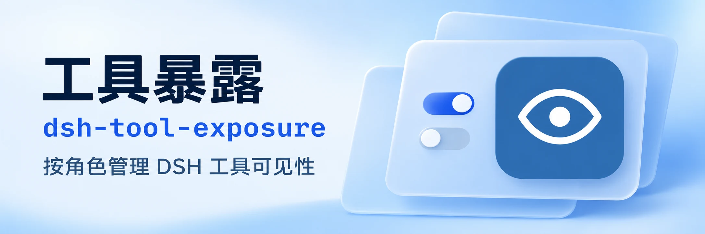
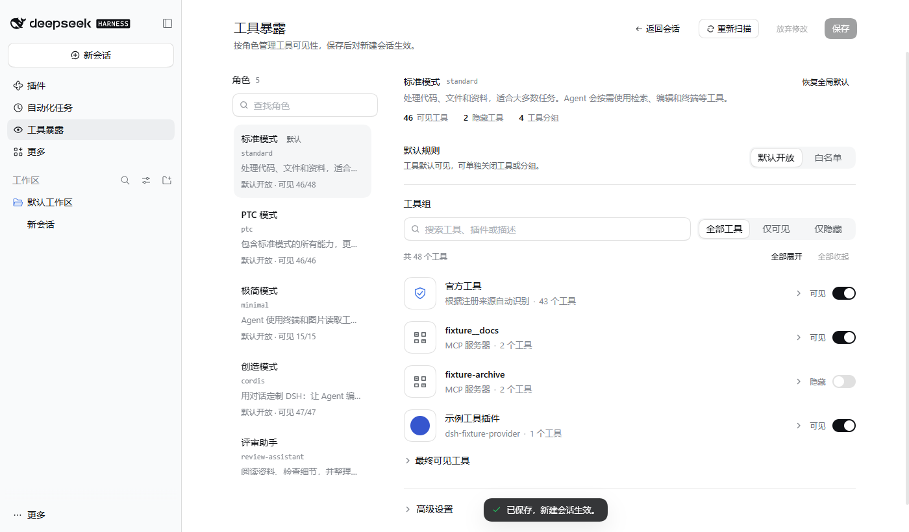

# 工具暴露 · dsh-tool-exposure

用同一个页面为标准模式、极简模式和自定义角色分别设置可见工具。按官方工具、插件或 MCP 服务器成组调整，也可以为单个工具设置例外。隐藏一个 MCP 服务器时，它在系统提示词里的说明与服务器名单也一并消失，不再污染上下文。

[安装](#安装) · [快速上手](#快速上手) · [工具分组](#工具分组) · [文档](#文档)

## 安装

适用于使用官方 `dsh-base` 的 DSH，支持版本 `>=0.2.2-alpha.3 <0.3.0-0`。使用 Node.js 运行 DSH 时，需要 Node.js 24.9 或更高版本。

### 在 DSH 界面从 npm 安装（推荐）

1. 打开 DSH 左侧菜单中的「插件」。
2. 点击「添加插件」旁的下拉箭头，选择「安装第三方插件」。
3. 在弹窗中输入 `dsh-tool-exposure`，点击「安装」。[查看 npm 包](https://www.npmjs.com/package/dsh-tool-exposure)

### 用 DSH CLI 从 npm 安装

**Web profile**

```sh
dsh plugin --profile web add dsh-tool-exposure
```

**Desktop profile**

先启动一次桌面版以初始化 profile，完全退出应用后，用**桌面版自带的 `dsh`** 执行命令。[DSH 桌面版 CLI 文档](https://github.com/deepseek-ai/deepseek-harness/blob/dsh-v0.2.2-rc.3/apps/desktop/README.zh.md#bundled-command-runtime)

```sh
dsh plugin --profile desktop add dsh-tool-exposure
```

可以从桌面端的「管理 dsh 命令…」注册内置 CLI，也可以直接调用安装目录下的 `resources/runtime/cli/bin/dsh`。Windows 使用同目录下的 `dsh.cmd`。

<details>
<summary>从 GitHub 仓库安装</summary>

在 DSH 的「安装第三方插件」弹窗中粘贴本仓库链接，点击「安装」。

```text
https://github.com/keyblues/dsh-tool-exposure
```


</details>

安装完成后重启对应的 DSH，从左侧菜单打开带眼睛图标的「工具暴露」。入口收纳在「更多」时，可以从那里打开或固定到侧栏。

## 快速上手

首次安装会自动读取当前角色和工具，各角色默认开放。

1. **选择角色。** 根据名称或预设 ID 找到要编辑的角色，例如「标准模式」。
2. **选默认规则。** 「默认开放」适合隐藏少量工具。「白名单」适合只开放选中的工具。
3. **调整组和工具。** 关闭某个 MCP 服务器组可隐藏它提供的全部工具和系统提示词里的说明；组内工具被逐个全部关闭时说明同样隐藏。展开组后，可以单独开启需要保留的工具。
4. **核对并保存。** 展开「最终可见工具」查看草稿结果。保存后用同一个角色新建会话，新会话会采用这套规则。



## 工具分组

| 来源 | 页面中的分组方式 |
| --- | --- |
| 官方插件 | 汇总在「官方工具」组，展开可查看每项工具的提供插件。 |
| 全局 MCP | 每个已注册的服务器单独成组，组名使用服务器名称；没有工具、只提供说明或资源的服务器同样成组，开关管理其提示词。 |
| 第三方插件 | 按注册工具的插件分组，优先展示插件名称和图标。 |
| 自定义组 | 在「高级设置 → 管理工具组」用工具名或通配符匹配。 |

DSH 会把 MCP 服务器名单与每个服务器的 instructions 直接写进系统提示词，`tools.restrict()` 管不到它们。本插件为每个会话注册作用域内的系统提示词监听器，按同一套组策略裁剪这些段落：服务器隐藏时其说明与名单条目一起消失，资源工具全部隐藏时整段名单删除，无需变化时逐字节保留原文以稳定前缀缓存。

可以按工具名、说明、插件名或 MCP 服务器名搜索，再筛选「仅可见」或「仅隐藏」。筛选后，整组开关仍作用于该组的全部工具。

## 文档

- 查找工具、处理草稿与升级插件。[使用指南](docs/usage.md)
- 查看分组顺序、角色规则及 YAML 示例。[配置参考](docs/configuration.md)
- 了解本地调试、测试和发布流程。[开发指南](docs/development.md)

Tool Exposure manages which inherited tools each DeepSeek Harness agent preset can see, and hides the matching MCP server prompt text along with the tools. Saved policies apply to new sessions.

## 许可

[MIT](LICENSE)
